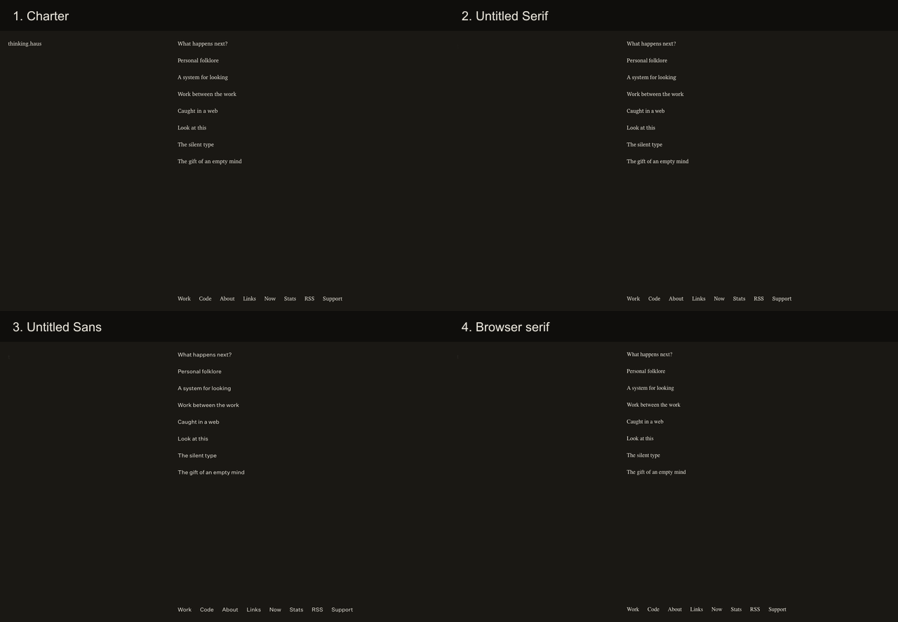
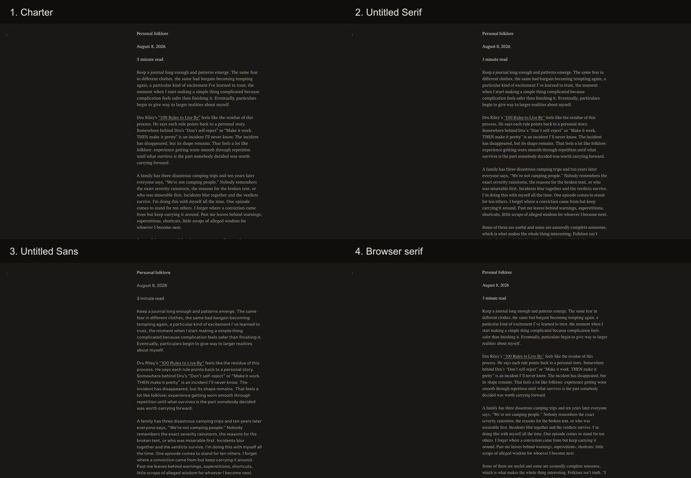
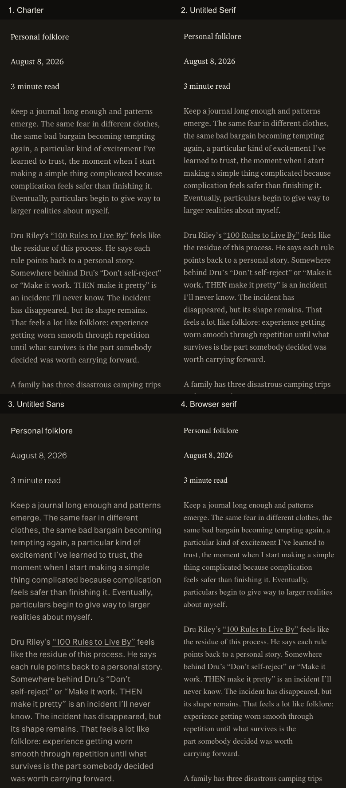
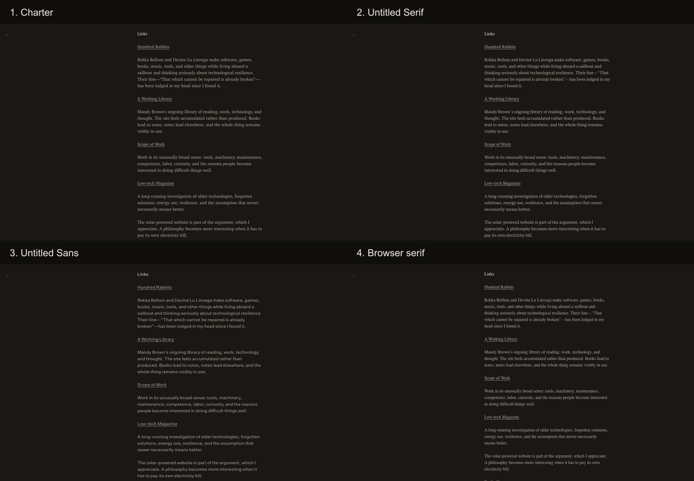
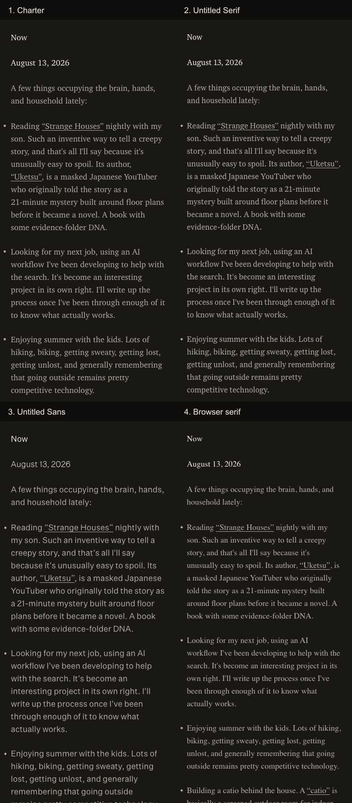
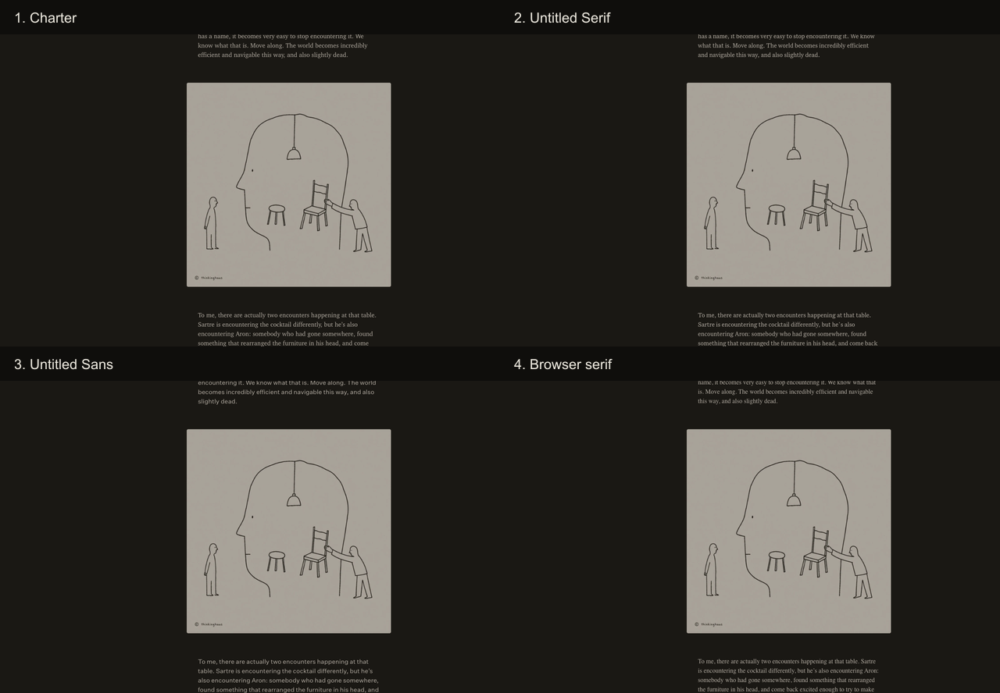
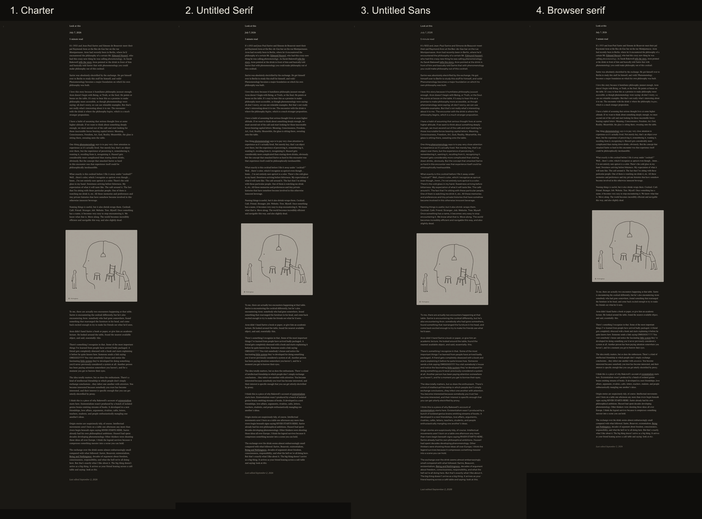

# Keepinghaus typography-in-use test

## Conclusion

Charter survives the expanded test.

It does not win by being the least noticeable typeface in isolation. The browser serif is more generic, and Untitled Sans is more formally neutral. Charter wins because, in these pages, it leaves the care visible while keeping the designer's hand comparatively quiet. It makes the site feel tended without turning typography into the subject.

The original diagnosis, “too much character,” is not precise enough. The more useful distinction is **perceived design presence** or **typographic self-consciousness**. Untitled Sans has less overt letterform character than either serif, yet it produces the strongest sense that a contemporary designer selected a typeface to make a statement. The test therefore supports the hypothesis that less formal character can create more perceived design presence.

## Audit scope

The comparison used the current static build and real pages:

1. Index: the accumulated list of posts.
2. Normal prose: “Personal folklore.”
3. Long prose and media: “Look at this.”
4. Persistent underlined links: “Links.”
5. Lists and small secondary information: “Now.”

Every condition was captured at 1280 × 800 and 390 × 844 in the same headless Chromium browser. All screenshots are full-page captures; the direct composites use matching viewport crops. The visible site name remains `thinking.haus` because source content was deliberately frozen for this test.

The checked-in stylesheet currently uses Untitled Sans. Per the requested study, Charter is labeled the evaluative baseline. No claim is made here that the working-tree CSS itself is Charter.

## Controlled variables

- Content, DOM, layout, grid, article measure, padding, spacing, colors, weights, line heights, links, images, and viewport were held constant.
- Desktop remained 16px/24px. Mobile remained 18px/28px.
- The desktop article column measured 465.125px in every condition.
- The media block in “Look at this” measured 523px high in every condition.
- Only the font family and its corresponding files changed.
- No metric compensation was made.
- External tracking was blocked during capture.
- Font loading completed successfully for all four conditions, and the expected family was confirmed in computed styles.

The browser/system control resolves to Chromium's generic serif. It is intentionally a control, not a proposed replacement.

## Direct comparisons

### Index, desktop

### Normal prose, desktop

### The same prose, mobile

### Link-heavy page, desktop

### List-heavy page, mobile

### Media within long prose, desktop

### Whole-page rhythm in long prose

## Measurable changes caused by font metrics

The dimensions below are outcomes, not compensations. Width and line height stayed fixed; the font changed line breaks and therefore total page length.

| Page / viewport | Charter | Untitled Serif | Untitled Sans | Browser serif |
|---|---:|---:|---:|---:|
| Personal folklore / desktop | 1548px | 1500px | 1596px | 1476px |
| Personal folklore / mobile | 2424px | 2368px | 2508px | 2312px |
| Look at this / desktop | 3559px | 3511px | 3631px | 3295px |
| Look at this / mobile | 4816px | 4788px | 5124px | 4536px |
| Links / desktop | 2676px | 2652px | 2700px | 2580px |
| Now / desktop | 924px | 924px | 948px | 876px |

On the first paragraph of “Personal folklore,” Charter, Untitled Serif, and the browser serif each used six desktop lines. Untitled Sans used seven. Across the long mobile page, Untitled Sans added 308px over Charter, about 6.4%. The important perception is not simply that Sans is longer. Its larger apparent x-height and even texture make each line feel more assertive while also producing more scrolling.

## Observations by typeface

### 1. Charter

**Reading.** Charter gives the best balance of pace, differentiation, and ease. Its forms remain legible at the muted body color, and the page develops a comfortable horizontal rhythm without becoming typographically eventful. Hierarchy is modest but readable because the face distinguishes title, metadata, prose, links, and italics through texture even when their CSS sizes are close.

**Presence and authorship.** The typeface is noticeable at first glance, but attention moves to the words quickly. The design feels cared for rather than branded. On the index it adds warmth to what could otherwise be a stark list. On long prose it becomes infrastructure.

**Ordinariness and plainness.** This is not an unstyled browser page. Its ordinariness feels deliberately cultivated, but the cultivation does not become the subject. The strongest counterargument is that Charter carries literary and old-web associations and can make the site feel a little more like a reading room than an ordinary page.

**Warmth and inhabitation.** Strongest of the four. The irregularity and familiar serif texture make accumulated pages feel kept over time. It supports the sense that a person has been placing things here.

**Strongest evidence for.** It preserves visible care without causing the typeface choice to dominate the reading experience.

**Strongest evidence against.** It is not neutral; it lends a gentle literary and slightly retrospective tone, especially on the index and mobile title blocks.

### 2. Untitled Serif

**Reading.** Sustained reading is excellent and slightly more compact than Charter. It keeps the long page controlled without looking small. The text color is even, links remain clear, and italics are graceful.

**Presence and authorship.** Its polish becomes visible more often. The crisp shapes, refined proportions, and especially the italic “Last edited” line make the selection feel intentional in an editorial sense. It recedes while reading but reappears at moments of hierarchy.

**Ordinariness and plainness.** It remains recognizably a web document, but one with a contemporary literary or independent-publication identity. The plainness feels designed. At times it feels designed *as plainness*.

**Warmth and inhabitation.** Warm, but more composed than lived-in. Compared with Charter it suggests a finished issue, essay platform, or small press more readily than a place where material has accumulated.

**Strongest evidence for.** It is the most refined serif reading experience and preserves the document-led layout without the genre shift created by Sans.

**Strongest evidence against.** Its refinement raises the visibility of authorship. The page becomes more editorial and slightly more precious.

### 3. Untitled Sans

**Reading.** It is clear and highly legible, particularly on the link and index pages. In long prose, however, the large apparent x-height and uniform color make the page more continuous and less breathable. At unchanged measures it wraps more, adding roughly 3–6% to the tested prose pages. The hierarchy reads cleanly, but metadata begins to resemble interface labels.

**Presence and authorship.** It is the first typeface noticed and the last to disappear. This is the paradox at the center of the test: its letterforms are restrained, but its use here is conspicuous. Against the warm dark palette, serif-led reading expectations, sparse document structure, and broad negative space, the sans becomes a contemporary design gesture.

**Ordinariness and plainness.** It is formally quotidian but experientially authored. The index can feel cleanly ordinary, yet the article pages read as a portfolio, design publication, or intentionally minimal product. The attempt to avoid character becomes legible as an aesthetic decision.

**Warmth and inhabitation.** Coolest of the designed faces. It is not unfriendly, but it makes the room cleaner and newer. Accumulation feels more curated; personal keeping feels more like publishing.

**Why the stated intention does not fully arrive here.** Several causes compound:

- The letterforms' evenness and large apparent x-height make a smooth, assertive text color.
- Sans-serif long-form text conflicts with the rest of Keepinghaus's warm, document-led visual language.
- Contemporary neutral grotesks carry strong associations with portfolios, institutions, product design, and editorial systems.
- Familiarity with Charter likely contributes, but does not explain the genre shift visible on first encounter.
- Serif expectations aid sustained reading here.
- Selecting a conspicuously “neutral” face is itself legible as a choice.

**Strongest evidence for.** It gives the index and link-heavy pages the clearest utilitarian directness, with excellent scanning and no decorative noise.

**Strongest evidence against.** It makes the design system more perceptible than the material. Formal restraint becomes high design presence.

### 4. Browser serif

**Reading.** Dense and efficient, with the shortest pages, but the smaller apparent size and thin, narrow texture are less comfortable against the dark surface. It reads adequately; it does not invite reading.

**Presence and authorship.** Individual letters recede, but “defaultness” becomes noticeable at the page level. The choice does not disappear; it announces the absence of a choice.

**Ordinariness and plainness.** This is the most literally ordinary condition. It establishes the useful lower bound: once typography becomes this recessive, the same spacing and palette can no longer make plainness feel fully chosen. The page feels generic, nostalgic, or unfinished depending on context.

**Warmth and inhabitation.** It can evoke the old personal web, but more as a period signal than as a lived place. The warmth comes from association, not from the immediate reading texture.

**Strongest evidence for.** It proves that Keepinghaus can remain structurally coherent with almost no typographic authorship.

**Strongest evidence against.** It drains too much care from the surface and makes the site feel default rather than deliberately plain.

## What changed perceptually

The same layout moved through four different genres:

- **Charter:** a cared-for personal place.
- **Untitled Serif:** an independent literary or editorial publication.
- **Untitled Sans:** a contemporary design-led portfolio or publishing system.
- **Browser serif:** an old or minimally styled web document.

The image page is particularly revealing because the image itself never changes. With Untitled Sans, the image reads more like portfolio work placed in a designed sequence. With Untitled Serif, it reads like an illustration in an essay publication. With the browser serif, it looks inserted into an old document. Charter gives it the least categorical framing: it remains simply something encountered in the page.

## Does the “quiet authorship” possibility hold?

The implementation supports it, provisionally. Keepinghaus does not benefit from making design invisible. The browser control shows that total recession can read as neglect or defaultness. It benefits from care that is perceptible in measure, tone, and rhythm while the expressive fact of typeface selection stays relatively quiet. Charter occupies that middle position most successfully in this implementation.

This should not be promoted to a universal principle. It is a result of these pages, this palette, this spacing, and this content. A lighter background, larger measure, different hierarchy, or less prose-heavy corpus could change the outcome.

## Final decision

The Charter decision survives.

Untitled Serif is the credible alternative and the strongest reading competitor, but it raises editorial authorship. Untitled Sans is useful evidence precisely because it does not behave as its abstract description predicts: here, the formally neutral choice is the most conspicuously designed. The browser serif confirms that “ordinary” alone is insufficient.

The better diagnosis is not that the alternatives have too much character. It is that they create the wrong **relationship between care and authorship**. Charter lets care remain visible while keeping authorship quieter than the material.

## Evidence limits

- The current published corpus contains headings, dates, links, lists, italics, and media, but no rendered article subheading. The H2 component exists in code; no synthetic subheading was inserted because source content was frozen. Its in-use typography remains untested.
- This is a visual and reading-rhythm assessment, not a formal accessibility compliance audit.
- Reading comfort was judged from rendered pages and repeated visual inspection, not from a timed reader study.
- The browser serif is environment-dependent and should be understood as a control rather than a stable font specification.

Visible accessibility signals remained stable: links kept persistent underlines in prose, the mobile pages reflowed without horizontal overflow, and font sizes and line heights did not change across conditions. The browser serif's thinner apparent strokes against the dark surface are a plausible legibility risk. Zoom behavior, assistive-technology output, and contrast compliance were outside this typography-only visual test.

## Output

- Full interactive gallery: [gallery.html](gallery.html)
- Post-ready draft: [post/keepinghaus-typography-test.md](post/keepinghaus-typography-test.md)
- Post-ready images: [post/images](post/images)
- All 40 full-page captures: [screenshots](screenshots)
- Comparison PNGs: [comparisons](comparisons)
